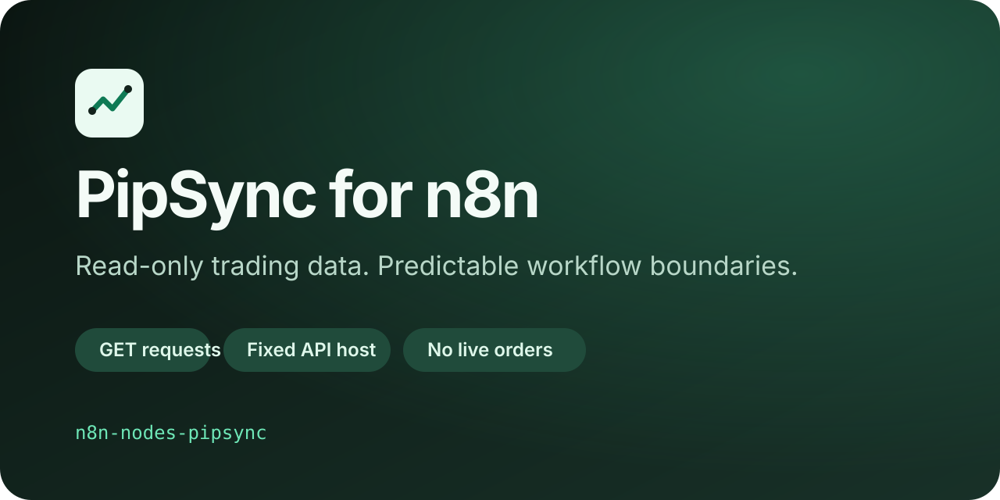

# n8n-nodes-pipsync

A deliberately read-only n8n community node for the documented public [PipSync](https://pipsync.io) API.

> **Pre-publication status:** this repository is prepared for review, but the package has not been published to npm and has not been verified by n8n.

The node reads account and trading records for reporting workflows. It cannot receive webhooks, submit signals, manage brokers, call MCP tools, or place, change, or close orders.



## Operations

Every operation uses `GET` against the fixed base URL `https://app.pipsync.io/api/v1`.

| Resource        | n8n operation | API path             | Parameters                                |
| --------------- | ------------- | -------------------- | ----------------------------------------- |
| Profile         | Get           | `/me`                | None                                      |
| Usage           | Get           | `/account/usage`     | None                                      |
| Signal          | Get Many      | `/signals`           | `limit`, `since`                          |
| Trade           | Get Many      | `/trades`            | `limit`, `status`                         |
| Report          | Get Many      | `/reports`           | None                                      |
| Report Schedule | Get Many      | `/reports/schedules` | None                                      |
| Trade Report    | Get           | `/reports/trades`    | `format`, `limit`, `status`, `from`, `to` |

Trade reports return normal n8n JSON for `json`. The `csv` and `pdf` formats are returned in the `data` binary property with a deterministic filename and MIME type.

JSON operations preserve the documented PipSync response envelope. Collection records therefore remain under `$json.data`, while counts and limits remain under `$json.meta`; the node does not discard API metadata.

## Safety boundary

- The API host is compiled into the node. There is no base-URL credential field and no arbitrary request path.
- Requests have redirects disabled and restrict authenticated egress to `app.pipsync.io`.
- The runtime package contains no third-party runtime dependency other than the `n8n-workflow` peer supplied by n8n.
- The node does not read files, environment variables, or shell state and does not run analytics.
- API responses are not treated as trading instructions. This integration performs no order execution.
- Error output is deliberately generic and never includes the credential or raw HTTP request configuration.
- n8n can present the same node as an AI tool, as required by the current community-node linter. That surface receives no extra operation: it remains limited to the same seven reads and fixed host. The package implements no MCP server or MCP function.

The source-level route allowlist is in [`nodes/PipSync/contracts.ts`](nodes/PipSync/contracts.ts). A reviewable API snapshot is in [`contracts/pipsync-public-readonly.snapshot.json`](contracts/pipsync-public-readonly.snapshot.json).

## Credentials

1. Create or retrieve an API key in your PipSync account.
2. In n8n, create a **PipSync API** credential.
3. Paste the key into the password-masked **API Key** field.
4. Run the credential test. It makes a read-only request to `GET /me` on the fixed official host.

n8n encrypts saved credentials using the n8n instance encryption configuration. This node asks n8n to inject the bearer header at request time and does not read or log the key itself. Use the least-privileged key available, limit who can use the credential in n8n, and rotate it immediately if it may have been exposed.

The documented public API is available according to your PipSync plan. A valid key can still receive `403` when a resource is not included in the account tier.

## Install

This package is not on npm yet. Do not treat the package name as installable until a provenance-bearing release is visible on npm and linked from this repository.

For local review and development:

```bash
git clone https://github.com/pipsyncio/n8n-nodes-pipsync.git
cd n8n-nodes-pipsync
npm ci --ignore-scripts
npm run verify
npm run dev
```

The development environment requires Node.js 22.22.0 or newer. `npm run dev` uses the official `n8n-node` development runner.

After an authorized npm release, self-hosted n8n administrators can install `n8n-nodes-pipsync` through **Settings → Community Nodes**. Follow your organization's change-control policy before enabling any community package.

## Example workflow

1. Add a trigger such as **Schedule Trigger**.
2. Add **PipSync** and select **Trade Report → Get**.
3. Keep **Format** set to **JSON**, choose a conservative row limit, and optionally set a time range.
4. Connect a reporting or storage node to the result.

This workflow reads historical records only. A downstream workflow is responsible for how the returned data is stored or shared.

## Development and verification

```bash
npm ci --ignore-scripts
npm run format:check
npm run lint
npm run build
npm test
npm run scan:credentials
npm run pack:check
```

`--ignore-scripts` avoids running install hooks from transitive development tools; the explicit repository build and verification commands still run immediately afterward. `npm run verify` runs the full sequence. Tests use Node's built-in test runner and do not make PipSync network requests. The custom scan fails closed when it finds a write method, an arbitrary URL surface, file/environment/shell access in node runtime code, an unmasked credential, or an unexpected packed file.

The repository pins `@n8n/node-cli` and the TypeScript toolchain in `package.json` and `package-lock.json`. CI has read-only repository permissions. The separate publishing workflow is manual, OIDC-only, confirmation-gated, and prepared for npm provenance; it has not been run.

See:

- [`docs/VERIFICATION.md`](docs/VERIFICATION.md) for the n8n rule research and current readiness evidence
- [`PUBLISHING.md`](PUBLISHING.md) for the human release checklist
- [`SECURITY.md`](SECURITY.md) for private vulnerability reporting
- [`CONTRIBUTING.md`](CONTRIBUTING.md) for the non-negotiable read-only contribution boundary

## Limitations

- The node exposes only the seven public API resources listed above.
- It does not paginate beyond the API's documented per-request limits because the public contract does not document a pagination cursor.
- Local tests use mocked HTTP helpers. A maintainer must perform an authorized smoke test with a non-production, least-privileged key before the first release.
- Repository preparation does not reserve the npm package name, create npm trusted-publisher settings, prove ownership, or grant n8n verification.
- PipSync and n8n may evolve independently. Review the contract snapshot and compatibility metadata before every release.
- The current official n8n development toolchain has transitive, development-only caveats recorded in [`docs/VERIFICATION.md`](docs/VERIFICATION.md); the runtime audit is clean, but those upstream findings still require release-time review.

## Support

- Managed API access: [create a PipSync account](https://pipsync.io/signup?utm_source=github&utm_medium=repository&utm_campaign=developer-tools&utm_content=n8n-node)
- Integration guidance: [PipSync integrations](https://pipsync.io/en/integrations?utm_source=github&utm_medium=repository&utm_campaign=developer-tools&utm_content=n8n-node)
- Integration bug or feature request: [GitHub Issues](https://github.com/pipsyncio/n8n-nodes-pipsync/issues)
- PipSync account or API access: [PipSync Support](https://pipsync.io/support)
- Security report: follow [`SECURITY.md`](SECURITY.md)

## License

[MIT](LICENSE). PipSync is a trademark of its respective owner. n8n is a trademark of n8n GmbH. This package is a community integration and is not an n8n GmbH product.
